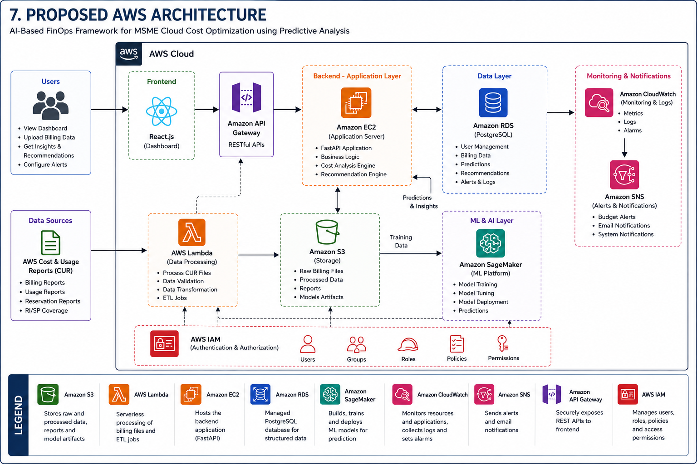
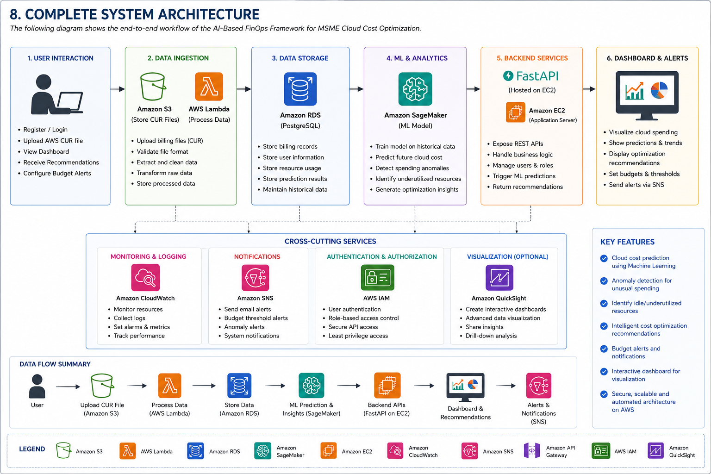

# CloudWise AI - Cloud Architecture Project 2026

## Project Title
**AI-Based FinOps Framework for MSME Cloud Cost Optimization using Predictive Analysis**

---

## Team Members

- Ridhima Singh – Frontend Development
- Rahul Ganesan – Backend & AWS Integration
- Akhilesh Reddy – AI/ML & Predictive Analysis

---

# Problem Statement

Micro, Small, and Medium Enterprises (MSMEs) increasingly rely on cloud platforms such as AWS for hosting applications and storing data. However, many organizations struggle to manage cloud expenses due to dynamic pricing, over-provisioned resources, idle services, and the lack of cost prediction mechanisms. Existing cloud monitoring tools primarily provide historical billing information but offer limited predictive insights and intelligent recommendations.

This project proposes an AI-powered FinOps framework that predicts future cloud expenditure, identifies unnecessary resource utilization, and provides optimization recommendations to reduce operational costs while maintaining performance.

---

# Objectives

- Predict future cloud expenditure using machine learning.
- Detect abnormal cloud spending patterns.
- Recommend intelligent cost optimization strategies.
- Visualize cloud resource utilization using interactive dashboards.
- Improve cloud resource efficiency for MSMEs.
- Integrate AWS cloud services into a scalable architecture.

---

# Technology Stack

## Frontend
- React.js
- Tailwind CSS
- Hand-built SVG charts (no chart library)

## Backend
- FastAPI
- Python
- REST API

## Database
- PostgreSQL

## AI / Machine Learning
- Pandas
- NumPy
- Scikit-learn
- XGBoost

## Cloud (AWS)
- Deployed (Sydney, ap-southeast-2, 19 October 2026): Amazon S3 and CloudFront, API Gateway, Amazon EC2, Amazon RDS, AWS IAM, CloudWatch, SNS
- Future work: AWS Lambda (CUR ingestion), Amazon SageMaker, Amazon QuickSight

---

# Proposed Architecture

## AWS Architecture



## System Architecture



The proposed framework consists of four major layers:

1. User Interface
2. Backend API Layer
3. AI Prediction Engine
4. AWS Cloud Infrastructure

The system collects cloud billing information, stores it securely, predicts future cloud costs using machine learning models, and recommends optimization strategies through an interactive dashboard.

---

# Dataset

Dataset: CloudWiseAI synthetic AWS billing dataset (CUR-style), generated by `dataset/generate_dataset.py`

- 15,950 daily records, 25 resources, 638 days (Jan 2025 - Sep 2026), 9 columns
- 8 injected anomaly events used only to evaluate the detector
- Fields modelled on the AWS Cost and Usage Report; real exports can be mapped to the same columns

Purpose:
Forecast future cloud expenditure, detect abnormal spending and generate optimization recommendations.

---

# Repository Structure

```text
CloudWiseAI_Cloud_Project_2026
├── docs
│   ├── Abstract.md
│   ├── DatasetDetails.md
│   ├── LiteratureSurvey.md
│   ├── Novelty.md
│   ├── Objectives.md
│   ├── ResearchGap.md
│   └── TechnologyStack.md
│
├── architecture
│   ├── AWSArchitecture.png
│   ├── SystemArchitecture.png
│   └── README.md
│
├── dataset
│   └── README.md
│
├── presentation
│   └── README.md
│
├── results
│   └── README.md
│
├── src
│   ├── frontend
│   │   └── README.md
│   ├── backend
│   │   └── README.md
│   ├── ml_model
│   │   └── README.md
│   └── aws
│       ├── DEPLOYMENT.md
│       ├── ec2_setup.sh
│       └── README.md
│
├── LICENSE
├── .gitignore
└── README.md
```

# Current Status

- Repository Structure Completed
- Documentation Completed
- AWS Architecture Completed
- System Architecture Completed
- Literature Survey Completed
- Research Gap Analysis Completed
- Dataset Planning Completed
- Frontend Completed (src/frontend)
- Synthetic Dataset + Generator Completed (dataset/)
- PostgreSQL Schema + Loader Completed (src/backend)
- FastAPI Backend (auth, costs, utilization, anomalies, recommendations, predictions) Completed
- Anomaly Detection, Recommendation Rules and Cost Forecasting Completed
- AI Assistant (src/backend + src/frontend) Completed
- AWS deployment (src/aws) Completed; deployed on 19 October 2026 and tests T09-T11 passed (screenshots in docs/aws/)

# Future Scope

- Per-user data and CUR upload, VPC Link instead of an open port 8000, MFA and IAM administrator sign-in, assistant on AWS
- Real-time AWS billing integration (Lambda CUR ingestion)
- Validation on real billing exports
- Budget alerts
- Automatic cloud optimization suggestions

## Results (synthetic dataset)

- Anomaly detection: all 8 injected events found, precision and recall 1.00; a rolling 3-sigma baseline raised 57 false-alarm events (precision 0.24)
- Forecasting: ridge model, mean monthly MAPE 0.45% vs 2.47% for seasonal-naive
- Recommendations: six rules, about $7,507 per month of estimated savings

These figures come from synthetic data and need validation on real invoices. See `results/` and the project report.

## Running locally

See `src/backend/README.md` and `src/frontend/README.md`. For the AWS deployment procedure see `src/aws/DEPLOYMENT.md`.

## Team and Roles

| Member | Roll No. | Area |
|---|---|---|
| Rahul Ganesan | 24BIT0257 | Backend (FastAPI, PostgreSQL), dataset, ML analysis integration, AWS design and deployment kit |
| Ridhima Singh | 24BIT0260 | Frontend (React) edits and review |
| Akhilesh Reddy | 24BIT0352 | AI/ML (assigned) |

See the project report for the full contribution table and evidence.
