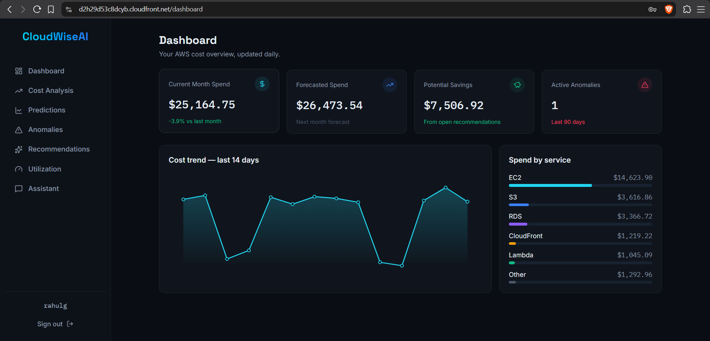
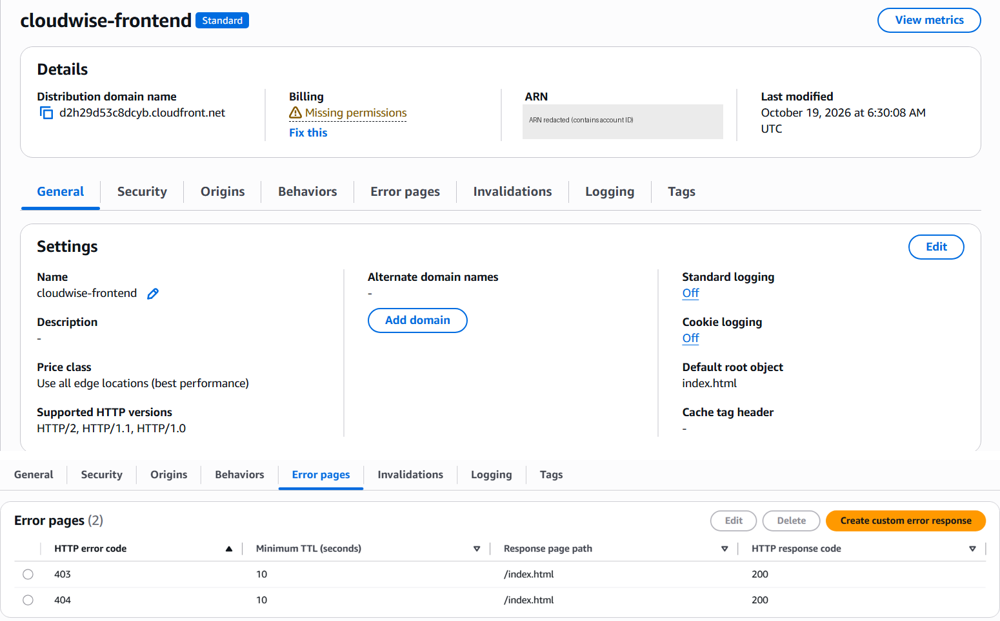
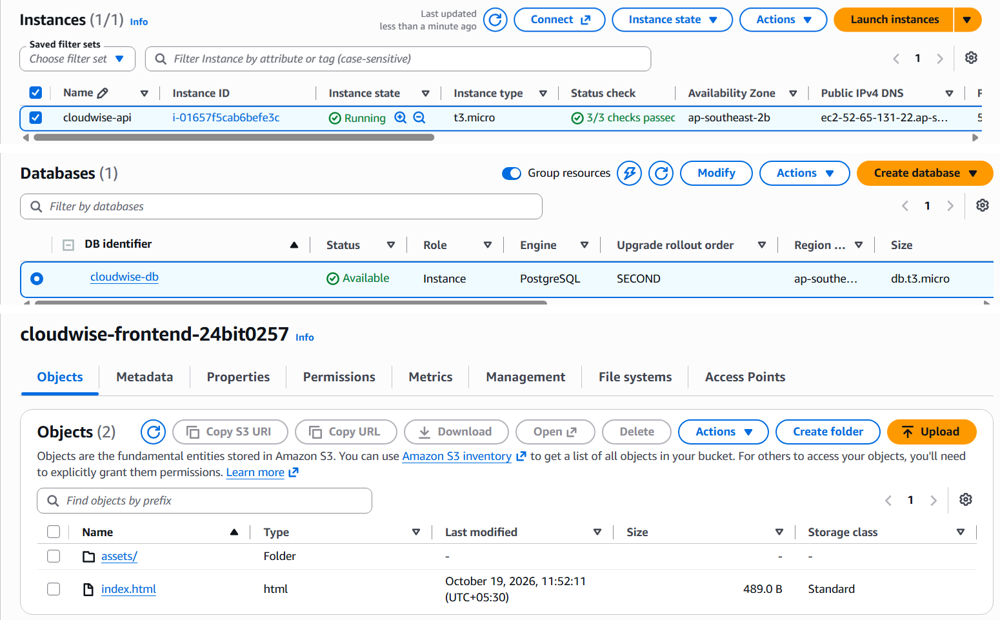
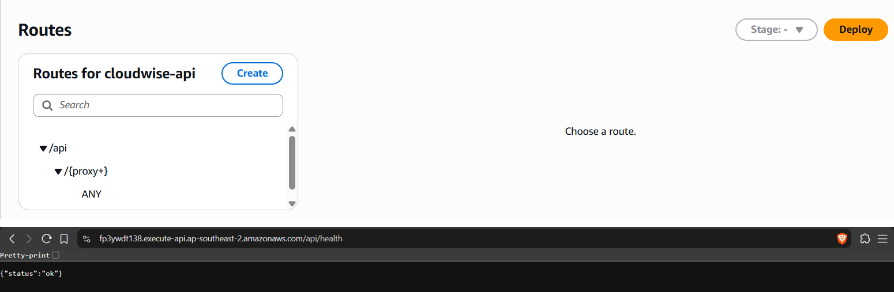
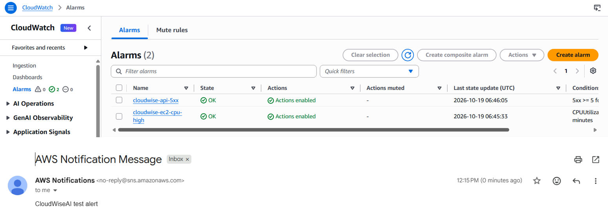

# Live AWS deployment (19 October 2026)

Region: Asia Pacific (Sydney), `ap-southeast-2`. Screenshots are cropped and the account ID is redacted.

| Test | Check | Result | Evidence |
|---|---|---|---|
| T09 | CloudFront site loads over HTTPS, sign-up/sign-in works, reload of `/dashboard` works, dashboard shows live data | Pass | 11, 12 |
| T10 | `GET /api/health` through API Gateway returns `{"status":"ok"}` | Pass | 14 |
| T11 | SNS test e-mail received; both CloudWatch alarms in OK state | Pass | 15 |

Resources (EC2, RDS, S3): [13](13-ec2-rds-s3.png).

Known limits: all users share one synthetic dataset, port 8000 is open to the internet, MFA is not enabled, and the assistant is not configured on AWS. The resources are deleted after evaluation (order in `src/aws/DEPLOYMENT.md`).

